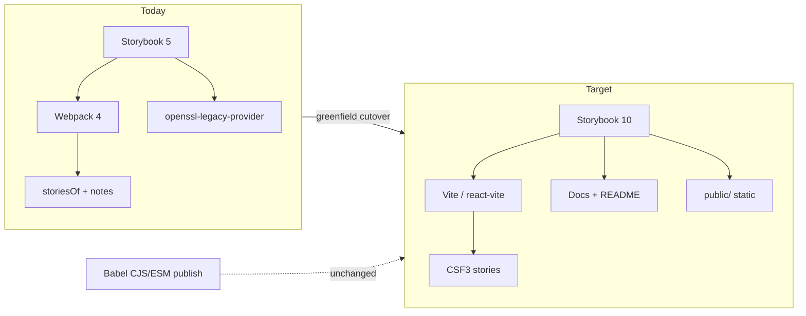

# refactor: Modernize Storybook/dev stack

## Goal Capsule

Replace the abandoned Storybook 5 / Webpack 4 demo toolchain with Storybook 10 + Vite so local `dev` and the static demo site build without OpenSSL hacks, while keeping the published ScrollScene library API and Babel dual-build untouched.

**Authority:** confirmed solo scope (2026-08-08) + this plan's KTDs.
**Stop when:** `pnpm storybook` and `pnpm build` succeed on the new stack, the 26 scroll demos behave, Vercel/static output still lands in `public/`, and high/critical audit noise from the old Webpack/SB5 graph is gone — without changing published runtime deps.

---

## Product Contract

### Summary

Modernize the local Storybook/dev stack that powers demos and the Vercel static site. Preserve existing ScrollScene / ScrollObserver demo behavior. Do not widen into a library publish rewrite or a full lint/format/release tooling overhaul.

### Problem Frame

The demo stack is Storybook 5 + Webpack 4 + React 16 + TypeScript 3. It requires `NODE_OPTIONS=--openssl-legacy-provider`, carries ~93 transitive advisories (mostly high/critical in the Webpack/SB5 graph), and blocks normal Node 20 development. Production npm deps already audit clean; the debt is demo/dev-only.

### Requirements

- R1. Local Storybook starts with the modern CLI (`storybook dev`) on the configured port without OpenSSL legacy provider flags.
- R2. Static Storybook build succeeds and continues to emit into `public/` for the existing Vercel static deploy.
- R3. All current demo kinds remain available: ScrollScene (toggle, events, gsap, duration, controller, Examples) and ScrollObserver (toggle, gsap, video, callback, multiple events) — 26 stories total.
- R4. Demo stories clean up listeners/timelines on story switch (existing `destroy()` / effect cleanup behavior preserved).
- R5. Demo video asset (`/media/demo.webm`) loads under the new static-file mapping.
- R6. README content remains reachable from Storybook Docs (replacing per-story addon-notes dumps).
- R7. Published package surface stays unchanged: Babel CJS/ESM dual-build scripts, `dependencies`, and `peerDependencies` are not part of this work unless a demo-only resolution forces a local override.
- R8. After cutover, `pnpm audit --prod` remains clean; full-tree high/critical findings tied to Webpack 4 / SB5 should be gone or sharply reduced.

### Key Decisions

- KD1. Greenfield Storybook 10 + `@storybook/react-vite` instead of sequential major upgrades — official `upgrade` is major-by-major and SB5→10 is not a supported one-shot. Governs R1, R2.
- KD2. Leave library Babel publish path alone — demo modernization must not become a package-build rewrite. Governs R7.
- KD3. Drop knobs (registered but unused today); replace notes with Docs rather than inventing Controls args unless a story truly needs them. Governs R3, R6.
- KD4. Bump demo React to 18 and TypeScript to 5.x as storybook/devDependencies only. Governs R1, R3.
- KD5. Defer ESLint / Prettier / TSLint / release-it modernization — out of this plan unless a blocker appears. Governs scope.

### Scope Boundaries

**In scope**
- `.storybook` config rewrite to `main` / `preview`
- Storybook + Vite + React 18 + TypeScript 5.x for demos (devDependencies; see KD4 / KTD notes on publish typecheck)
- CSF3 migration of `src/stories/*`
- Scripts (`dev`, `storybook`, `build`, `build:storybook`), `vercel.json` OpenSSL env removal
- Static dirs / media path for demo video
- Node engine floor bump within Node 20 if SB10 requires ≥20.19

**Out of scope**
- Changing published library API or Babel CJS/ESM emit
- Churning consumer `dependencies` / `peerDependencies`
- Full ESLint flat-config / Prettier 3 / release-it modernization
- Adding Vitest / visual regression / Chromatic

### Deferred to Follow-Up Work

- ESLint 6 → modern ESLint, remove TSLint
- Prettier 1 → current Prettier
- release-it 12 → current release-it
- Optional Controls args for demos that would benefit from interactive tuning
- Optional Storybook a11y / Vitest addons

### Actors

- A1. Library maintainer — runs Storybook locally and ships static demos via Vercel
- A2. Demo visitor — uses the static Storybook site to explore ScrollScene behavior

### Key Flows

- F1. Maintainer runs `pnpm dev` → Storybook UI loads → opens a scroll demo → scroll triggers expected class/GSAP/video behavior → switches stories without leaked listeners
- F2. Maintainer runs `pnpm build` → static site written to `public/` → Vercel serves it without OpenSSL flags
- F3. Visitor opens Docs → can read README-derived documentation alongside demos

### Acceptance Examples

- AE1. Fresh install on Node ≥20.19: `pnpm install && pnpm storybook` serves the catalog with all 26 stories listed. Covers F1 / R1 / R3.
- AE2. `pnpm build` exits 0, `public/index.html` exists, no `NODE_OPTIONS=--openssl-legacy-provider` required in `package.json` or `vercel.json`. Covers F2 / R2 / R8.
- AE3. ScrollScene GSAP demo and ScrollObserver video demo each work once; switching away and back does not double-fire or leave stale indicators. Covers F1 / R4 / R5.
- AE4. Docs (or equivalent) surfaces README content without the old notes addon. Covers F3 / R6.

---

## Planning Contract

### Assumptions

- Confirmed scope defaults: Storybook + required demo runtime/TS only; library publish left alone; one-pass jump to current Storybook + Vite; knobs dropped (unused) and notes → Docs.
- Institutional learnings (`docs/solutions/`) are empty — no prior local migration notes.
- React 16 still satisfies Storybook 10 peers, but React 18 is the intended demo target to avoid dead-end tooling friction.
- Splitting the monolith `story.js` by `storiesOf` group is preferred over one mega CSF file for maintainability.

### Key Technical Decisions

KD# (Product Contract) and KTD# (Planning Contract) are independent namespaces — equal numbers are not paired (e.g. KD2 ≠ KTD2).

| ID | Decision | Rationale |
|----|----------|-----------|
| KTD1 | Greenfield replace: delete SB5 config; scaffold Storybook 10 + `@storybook/react-vite` | Official upgrade path is major-by-major; SB8 removed `storiesOf`; Webpack4 custom config has no clean upgrade value for a demo-only site |
| KTD2 | Keep `storybook` core package + `@storybook/react-vite`; drop knobs/notes/storysource/webpack/ts-loader/fork-ts-checker | Matches SB9+ consolidation; removes the advisory-heavy graph |
| KTD3 | Migrate with `storiesof-to-csf` / `csf-2-to-3` as assist, then hand-split into one CSF file per former `storiesOf` group | Codemods help but will not correctly split 11 kinds in one 1687-line file |
| KTD4 | `staticDirs` preserve `/media/demo.webm`; `parameters.layout: 'fullscreen'` on scroll stories | Video path and scroll height are the main demo breakage risks under Vite/iframe |
| KTD5 | Docs: one README-backed docs entry (MDX or `parameters.docs`) instead of attaching full README to every story | Notes addon is gone; per-story README dumps were redundant |
| KTD6 | Bump `engines.node` / `.nvmrc` to a SB10-compatible Node 20 floor (≥20.19) | External contract for local + Vercel builds |
| KTD7 | Keep static output directory `public/` and script names familiar (`build` → storybook build) | Avoids Vercel `outputDirectory` churn |

### High-Level Technical Design

### Alternative Approaches Considered

| Approach | Why not |
|----------|---------|
| Sequential SB5→6→7→8→9→10 upgrades | High cost; storiesOf dies at SB8 anyway; knobs/notes already dead ends |
| Webpack 5 Storybook builder first | Demo site has no app Webpack investment; Vite is the recommended React path |
| Keep React 16 + only bump Storybook | Peers allow it, but manager/tooling friction and no upside for a demo-only React |

### Risks & Dependencies

| Risk | Mitigation |
|------|------------|
| Scroll demos break under Docs inline rendering | Prefer canvas iframe; set docs story inline/height carefully; verify fullscreen layout |
| ScrollMagic CJS interop under Vite | Smoke-test ScrollScene stories; add Vite `optimizeDeps` / alias only if required |
| TS 5 `noUnusedLocals` noise across `src/` | Prefer Storybook-local tsconfig for the app; avoid forcing a library emit rewrite |
| Codemod produces unsplit mega-file | Plan assumes hand-split by former `storiesOf` title |
| Residual audit findings in deferred ESLint/TSLint | Accept as follow-up; measure success by SB5/Webpack4 graph removal |
| Vercel build image Node below 20.19 | Pin Node via `.nvmrc` / Vercel Node setting to match `engines`; verify CI/deploy after engine bump |
| Codemod leaves broken JSX/effect bodies | Treat codemod output as draft; re-check every `useEffect` cleanup before merge |

### Open Questions

- Q1. *(deferred to implementation)* Does `scrollmagic` need a Vite `optimizeDeps` / `ssr.noExternal` tweak under Storybook 10? Resolve only if ScrollScene stories fail to boot.
- Q2. *(deferred to implementation)* Prefer `.storybook/main.ts` vs `.mjs` if the package `"type"` field or Storybook ESM loader fights CommonJS `require` leftovers — choose whatever boots cleanly.
- Q3. *(deferred)* Exact CSF filenames after split — suggested defaults in U2; implementer may adjust as long as titles preserve the former `storiesOf` hierarchy.

### System-Wide Impact

- Maintainers: new CLI commands, Node floor ≥20.19, no OpenSSL flag; local `.nvmrc` must stay aligned with Vercel
- Demo visitors: same static site contract (`public/`); story URLs/titles may change slightly where `|` becomes `/`
- npm consumers: no intended change to published tarball contents or peer range
- Deploy: `vercel.json` loses openssl env only; `outputDirectory: public` stays; confirm Node runtime on Vercel after engine bump

---

## Implementation Units

### U1. Scaffold Storybook 10 + Vite and cut over dependencies

**Goal:** Install the modern Storybook toolchain, rewrite `.storybook` to `main`/`preview`, update scripts, and remove SB5/Webpack4 packages and OpenSSL workarounds.

**Requirements:** R1 — KTD1, KTD6; R2 — KTD7; R7 — KD2; R8 — KTD2

**Dependencies:** none

**Files:**
- modify `package.json`
- modify `.nvmrc`
- create `.storybook/main.ts` (or `.js` if ESM constraints force simpler boot)
- create `.storybook/preview.ts`
- delete or stop using `.storybook/config.js`, `.storybook/addons.js`, `.storybook/webpack.config.js`
- modify `vercel.json`
- optional create `tsconfig.storybook.json` / vite config fragments Storybook expects

**Approach:**
1. Add `storybook` + `@storybook/react-vite` (+ docs addon as needed); bump demo `react`/`react-dom` to 18 and `typescript` to 5.x
2. Scaffold modern `.storybook/main` with `framework: '@storybook/react-vite'`, `stories` globs for CSF, `staticDirs` covering demo media
3. Point scripts at `storybook dev -p 8888` and `storybook build -o public` (keep port/output conventions)
4. Remove knobs/notes/storysource/webpack/ts-loader/fork-ts-checker and `NODE_OPTIONS=--openssl-legacy-provider` from `build` + `vercel.json`
5. Raise Node floor to ≥20.19 within the Node 20 line
6. Leave Babel publish scripts and runtime `dependencies` untouched

**Execution note:** Prefer install/runtime smoke (`storybook doctor`, empty/minimal story boot) before migrating all demos.

**Patterns to follow:** Official React + Vite install docs; keep `package.json` `config.dirStorybook*` conventions where they still help scripts.

**Test scenarios:**
- Happy path: with a minimal placeholder CSF story, `pnpm storybook` starts and `pnpm build` writes `public/index.html` without OpenSSL env
- Edge case: `pnpm exec storybook doctor` reports no mismatched Storybook package versions
- Integration: `vercel.json` build env no longer sets openssl-legacy-provider; `buildCommand` still produces `public/`

**Verification:** Modern CLI boots; legacy SB5 entry files are unused/removed; publish scripts still present and unchanged in intent.

---

### U2. Migrate demos to CSF3 with scroll-safe layout and static media

**Goal:** Convert all 26 demos from `storiesOf` to CSF3, preserve cleanup behavior, and keep video/media working.

**Requirements:** R3, R4, R5 — KTD3, KTD4

**Dependencies:** U1

**Files:**
- delete `src/stories/story.js` after migration
- create CSF modules (suggested):
  - `src/stories/ScrollScene.Toggle.stories.jsx`
  - `src/stories/ScrollScene.Events.stories.jsx`
  - `src/stories/ScrollScene.Gsap.stories.jsx`
  - `src/stories/ScrollScene.Duration.stories.jsx`
  - `src/stories/ScrollScene.Controller.stories.jsx`
  - `src/stories/ScrollScene.Examples.stories.jsx`
  - `src/stories/ScrollObserver.Toggle.stories.jsx`
  - `src/stories/ScrollObserver.Gsap.stories.jsx`
  - `src/stories/ScrollObserver.Video.stories.jsx`
  - `src/stories/ScrollObserver.Callback.stories.jsx`
  - `src/stories/ScrollObserver.MultipleEvents.stories.jsx`
- modify `src/stories/DemoVideo.tsx`, `src/stories/Stylesheet.js`, `src/stories/media.ts` as needed
- update Babel `--ignore` globs in `package.json` if story filenames change (e.g. `*.stories.*`)
- keep `.storybook/preview-head.html` styles or move equivalent global CSS into preview

**Approach:**
1. Run Storybook `storiesof-to-csf` / `csf-2-to-3` as a starting point, then split into one file per former `storiesOf` group (`ScrollScene|...` → `title: 'ScrollScene/...'`)
2. Preserve each story's `useEffect` create/destroy pattern and GSAP/ScrollObserver setup
3. Set fullscreen (or equivalent tall scroll) layout on scroll demos
4. Ensure `staticDirs` serves `/media/demo.webm` for `media.ts`
5. Do not invent Controls args — knobs were unused
6. Keep helpers (`DemoVideo`, `Stylesheet`, `media`) shared; stories import them rather than inlining duplicates

**Execution note:** Smoke-first per story group after conversion rather than waiting for a perfect monolith rewrite.

**Patterns to follow:** Existing effect cleanup in `src/stories/story.js`; helper components `DemoVideo`, `Stylesheet`.

**Test scenarios:**
- Happy path: each of the 11 former groups appears in the sidebar with the same story names
- Edge case: switching from a GSAP story to a video story leaves no active tweens / duplicate indicators
- Edge case: video stories play when the observer threshold is met
- Integration: library imports from `../ScrollScene`, `../ScrollObserver`, and `../index` (`addIndicators`) resolve under Vite

**Verification:** Manual pass of AE3 plus a checklist covering all 26 stories in canvas mode.

---

### U3. Replace notes with Docs and finish preview polish

**Goal:** Make README documentation available via Docs and remove residual SB5 notes wiring.

**Requirements:** R6 — KTD5

**Dependencies:** U2

**Files:**
- create docs entry (e.g. `src/stories/Introduction.mdx` or README-backed docs page)
- modify `.storybook/preview.ts` for docs parameters / global CSS (`normalize.css`, demo utility classes)
- update `README.md` only if Storybook usage instructions become wrong

**Approach:**
1. Stop importing README into every story as notes
2. Add a single Docs landing (or autodocs + markdown import) that surfaces README content
3. Confirm canvas demos are not forced into broken inline-docs scroll contexts

**Test scenarios:**
- Happy path: Docs shows README-derived content without the notes addon
- Edge case: opening Docs for a scroll story does not break the canvas version of that story
- Test expectation for pure copy tweaks in README: none beyond link accuracy

**Verification:** AE4 passes; no `@storybook/addon-notes` dependency remains.

---

### U4. Verification gate — deploy contracts and audit outcome

**Goal:** Prove the cutover meets deploy and security goals; remove leftover legacy Storybook artifacts.

**Requirements:** R2 — KTD7; R7 — KD2; R8 — KTD2 (also verify KTD6 Node floor on deploy)

**Dependencies:** U1, U2, U3

**Files:**
- modify `package.json` / lockfile as needed after final prune
- modify `vercel.json` if anything remains
- delete leftover SB5 files under `.storybook/` and unused demo-only deps (`styled-components` / `prop-types` only if confirmed unused and safe)

**Approach:**
1. Run full story checklist (F1) and production static build (F2)
2. Confirm `pnpm audit --prod` still clean
3. Compare full `pnpm audit` before/after — Webpack4/SB5 high/critical classes should be gone
4. Confirm Babel publish scripts untouched (`build:package`, `prepublishOnly`)
5. Optional: `pnpm exec storybook doctor`

**Execution note:** This unit is mostly packaging/config; prefer install/runtime smoke and the manual demo checklist over unit tests (no story test suite exists).

**Test scenarios:**
- Happy path: AE1–AE4 all pass on a clean install
- Integration: Vercel-oriented `pnpm build` output directory remains `public/`
- Regression: `pnpm run build:package` still runs without requiring Storybook (publish path independence)
- Security: full-tree audit no longer reports the previous Webpack4 loader-utils / SB5-era critical cluster (document any deferred ESLint/TSLint leftovers)

**Verification:** Definition of Done checklist complete; follow-ups filed only for deferred lint/format/release work.

---

## Verification Contract

No automated story test suite exists today. Verification is smoke + checklist.

1. `pnpm install` on Node ≥20.19
2. `pnpm storybook` (or `pnpm dev`) serves catalog on port 8888
3. `pnpm build` writes `public/` without OpenSSL legacy flags
4. Manual canvas checklist for all 26 stories (scroll, GSAP, video, callbacks, cleanup on switch)
5. Docs README entry loads
6. `pnpm audit --prod` clean; full audit reviewed for SB5/Webpack4 removal
7. `pnpm run build:package` still succeeds (library path untouched)

---

## Definition of Done

- [ ] Storybook 10 + `@storybook/react-vite` is the only Storybook stack
- [ ] SB5 files/deps (knobs, notes, webpack4 story tooling, openssl hacks) removed
- [ ] All 26 demos available as CSF and manually verified
- [ ] Docs replaces notes for README access
- [ ] Vercel/`public/` deploy contract preserved
- [ ] Published runtime deps and Babel dual-build unchanged
- [ ] Prod audit still clean; demo-stack critical/high cluster cleared or explained as deferred non-SB debt

---

## Appendix

### Sources & Research

- Repo research: SB5 layout in `.storybook/*`; 11 `storiesOf` groups / 26 stories in `src/stories/story.js`; knobs registered but unused; notes attach full `README.md`; `vercel.json` + `build` use openssl-legacy-provider; no story tests
- Official Storybook docs (2026): install/requirements 10.5, React+Vite framework, upgrading rules (major-by-major; 5→10 not one-shot), migration guides, Controls, story layout/rendering
- Best-practice synthesis: greenfield scaffold → smoke → CSF split → Docs; defer ESLint/Prettier/release-it; audit win is dropping Webpack4/SB5 transitive CVEs

### Product Contract preservation

Product Contract created in this bootstrap (`product_contract_source: ce-plan-bootstrap`); no upstream brainstorm to preserve.
