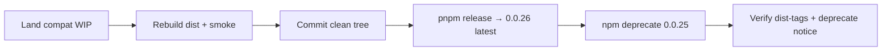
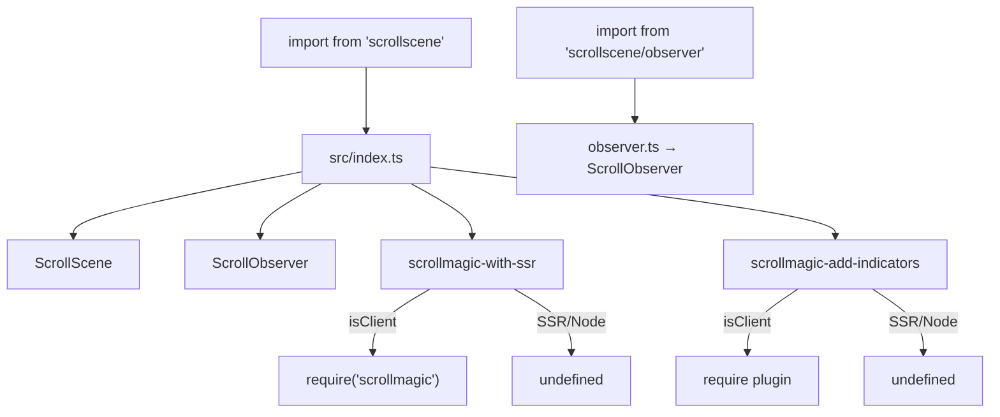

# fix: Compat hotfix release 0.0.26

## Goal Capsule

- **Outcome:** Publish `scrollscene@0.0.26` that restores `0.0.24`-style main-entry import/SSR behavior (no consumer syntax change), deprecate only `0.0.25`, and leave `./observer` additive for a later codemod-driven break. Auto-protection covers `latest` and ranges that float past `0.0.25`; `^0.0.25` / exact `0.0.25` need an explicit bump.
- **Authority:** Session-settled product constraints below; published `0.0.24` main-entry behavior is the compatibility baseline; Storybook/dev Node floor stays in `.nvmrc` only.
- **Stop when:** `latest` is `0.0.26`, registry post-publish Node smoke passes, `0.0.25` is deprecated with bump-to-`0.0.26` messaging that leads with the non-floating caret fact, and README does not require `scrollscene/observer`.

---

## Product Contract

### Summary

Ship a compatibility bridge after `0.0.25` forced (or strongly pushed) consumers toward new import/SSR behavior. Make `0.0.26` the new `latest` so floating ranges and new installs get the fix; warn anyone resolving `0.0.25` to bump explicitly (npm `^0.0.25` does not float to `0.0.26`, and lockfile pins may not see deprecate until re-resolve). Defer the intentional breaking syntax migration to a later release with a codemod.

### Problem Frame

`0.0.25` changed ScrollMagic loaders to static imports, leaked `engines.node` onto the published package, and docs treated `scrollscene/observer` as the ScrollObserver path. That breaks or pressures existing `import { … } from 'scrollscene'` usage—especially SSR—without a planned migration. A larger breaking release is planned later; this hotfix must not be that break.

### Requirements

- **R1.** Main entry keeps supporting `import { ScrollScene, ScrollObserver, addIndicators, ScrollMagic, ScrollMagicSsr } from 'scrollscene'` with no required path change.
- **R2.** ScrollMagic (and the addIndicators plugin) load only on the client behind `is-client`, matching the `0.0.24` SSR-safe pattern so Node/SSR evaluation does not touch `window`.
- **R3.** `scrollscene/observer` remains an optional additive entry for ScrollMagic-free installs; docs present it as optional, not required.
- **R4.** Published `package.json` must not declare a Node `engines` floor aimed at Storybook/demo tooling; keep `.nvmrc` for local/Vercel Storybook.
- **R5.** Publish `0.0.26` as the npm `latest` dist-tag.
- **R6.** Deprecate only `scrollscene@0.0.25` with a message that points to `0.0.26` and states no consumer code change is required for the upgrade.
- **R7.** Do not deprecate `0.0.23` / `0.0.24`. Do not implement the future forced-syntax / codemod release in this plan.
- **R8.** Keep Storybook/Vite demos working with restored client-only `require` loaders via `.storybook` shim/alias only (not by putting static ScrollMagic imports back into the published library).

### Key Decisions

- **KD1.** Compatibility baseline is `0.0.24` main-entry loader behavior (client-only `require`), not the `0.0.25` static-import shape. Governs R1, R2.
- **KD2.** Optional observer subpath and `exports` map stay; forced migration waits for a later release. Governs R3, R7.
- **KD3.** Deprecate only `0.0.25`; new patch is `0.0.26`. Governs R5, R6, R7.

### Scope Boundaries

#### In scope

- Land/finish WIP compat fixes (loaders, barrel, README, `sideEffects`, remove published `engines`, Storybook Vite shim).
- Smoke-verify package + Storybook indicators path.
- Release `0.0.26` and deprecate `0.0.25`.

#### Deferred for later

- Forced syntax migration, codemod, and any major/minor break that requires consumer import rewrites.
- Broader changelog/automation beyond this one-off deprecate + release.

#### Outside this product's identity

- Redesigning Storybook demos as a consumer-facing API.

### Assumptions

- WIP already on `master` (uncommitted) is the intended code starting point and needs verification + polish, not a greenfield rewrite.
- `npm whoami` as package owner remains available for publish/deprecate (OTP if 2FA).
- Future breaking release will own messaging/codemod; deprecate text for `0.0.25` stays focused on the hotfix.
- Accepting continued broken `latest` until `0.0.26` publishes is OK unless the Open Question below chooses an interim `latest`→`0.0.24` retag.

---

## Planning Contract

### Key Technical Decisions

- **KTD1.** Restore client-only `require('scrollmagic')` / `require('./plugins/debug.addIndicators')` behind `is-client` in `src/scrollmagic-with-ssr.ts` and `src/scrollmagic-add-indicators.ts`; drop the bare plugin side-effect import from `src/index.ts` so SSR never evaluates the plugin. `(session-settled: user-directed — chosen over keeping 0.0.25 static imports / forced observer path: existing main-entry syntax must keep working)`
- **KTD2.** Keep Storybook Vite working via `.storybook/shims/scrollmagic-with-ssr.ts` aliased from `.storybook/main.ts` only—do not put static ScrollMagic imports back into the published library loaders.
- **KTD3.** Keep `exports` with `.` and `./observer`; treat observer as additive opt-in. `(session-settled: user-approved — chosen over removing exports entirely: later codemod release will own the forced break)`
- **KTD4.** Remove published `engines.node`; leave `.nvmrc` at `20.19.0` for Storybook/Vercel. Align `sideEffects` with shipped dist index **plus** add-indicators and plugin globs (not only `src/` paths that never ship).
- **KTD5.** Release with existing `pnpm release` (`release-it`); rebuild is guaranteed by `prepublishOnly` (`.release-it.json` `buildCommand` is inert on release-it@12). Then run `npm deprecate scrollscene@0.0.25 "…"`. `(session-settled: user-directed — chosen over leaving 0.0.25 as latest without warning)`
- **KTD6.** Document honestly that npm `0.0.x` caret on `^0.0.25` does **not** satisfy `0.0.26`; deprecate message must say install/bump to `0.0.26` (not “npm update”). Loose ranges (`*`, `0.0.x`, `~0.0.23`, `>=…`) and new `latest` installs get the fix. *(conflict call-out: settled “protect floaters via latest” is suboptimal-but-workable for `^0.0.25` pins—they need an explicit bump; deprecation warning is the signal)*

### High-Level Technical Design

Loader boundary (published main entry):

### Risks & Dependencies

| Risk | Mitigation |
|------|------------|
| `^0.0.25` never auto-upgrades to `0.0.26` | Deprecate message + README/release notes: pin/bump to `0.0.26` |
| Storybook breaks on restored `require` | Keep Vite alias shim; smoke an indicators story |
| `addIndicators` tree-shaken away again | `sideEffects` includes dist index + add-indicators + plugin; client `require` of plugin when export is imported |
| Untracked shim not caught by release-it | release-it uses `--untracked-files=no`; explicitly `git add .storybook/shims/` and verify with `git ls-files --error-unmatch` before release |
| Lockfile pins on `0.0.25` may not see deprecate | README/release notes: bump manifest/lockfile to `0.0.26` (do not rely on seeing a warning) |
| Interactive release-it / npm OTP | Operator present; confirm `latest` + registry smoke before deprecate |

### Dependencies / Prerequisites

- Clean git working tree before `pnpm release`.
- npm auth as `jonkwheeler` (already verified in planning).
- Node matching `.nvmrc` for Storybook smoke.

---

## Implementation Units

### U1. Finish published compat surface

**Goal:** Complete the library + docs + Storybook shim so main-entry syntax and SSR-safe loading match the compatibility baseline while keeping `./observer` optional.

**Requirements:** R1, R2, R3, R4, R8

**Dependencies:** None

**Files:**
- `src/scrollmagic-with-ssr.ts` (modify)
- `src/scrollmagic-add-indicators.ts` (modify)
- `src/index.ts` (modify)
- `package.json` (modify — `sideEffects`, no `engines`; leave version bump to release-it)
- `README.md` (modify)
- `.storybook/main.ts` (modify)
- `.storybook/shims/scrollmagic-with-ssr.ts` (create)
- `.nvmrc` (verify only)

**Approach:**
1. Confirm WIP loaders use client-only `require` and barrel re-exports without a bare plugin import.
2. Confirm README primary examples use `from 'scrollscene'`; observer path documented once as optional; note lockfile/manifest bump for `0.0.26`.
3. Confirm `engines` absent from `package.json`; `.nvmrc` still pins demo Node.
4. Confirm Storybook aliases `src/scrollmagic-with-ssr.ts` to the static-import shim (R8).
5. `git add .storybook/shims/scrollmagic-with-ssr.ts` and confirm it is tracked (`git ls-files --error-unmatch`).

**Patterns to follow:** `0.0.24` loader shape; existing WIP on `master`.

**Test scenarios:**
- Happy path: after rebuild, `dist/commonjs/scrollmagic-with-ssr.js` and `dist/esm/scrollmagic-with-ssr.js` contain `require('scrollmagic')` inside an `is-client` guard.
- Edge: Node `require('scrollscene')` (or `./dist/commonjs/index.js`) does not throw `window is not defined`; `ScrollScene` / `ScrollObserver` typeof `function`; `ScrollMagic` / `addIndicators` are `undefined` on Node.
- Integration: `require('./dist/commonjs/observer.js')` exposes `ScrollObserver` without loading ScrollMagic.
- Error/failure: N/A for this unit beyond smoke failures blocking release.

**Execution note:** Prefer rebuild + Node smoke before Storybook; treat packaging smoke as the first proof.

**Verification:** Behavioral/loader parity vs published `0.0.24` main-entry SSR pattern (client-only `require` behind `is-client`, no `engines`, main-entry exports). Diff vs `0.0.25` is secondary “what we undid” evidence only. README must not require observer for ScrollObserver.

---

### U2. Smoke Storybook + indicators registration

**Goal:** Prove the Vite shim and client plugin registration still work for demos that call `Scene.addIndicators`.

**Requirements:** R8

**Dependencies:** U1

**Files:**
- `.storybook/main.ts` (verify)
- `.storybook/shims/scrollmagic-with-ssr.ts` (verify)
- `.storybook/preview.ts` (verify — still loads plugin for stories importing `ScrollScene` directly)
- `src/stories/ScrollScene.toggle.stories.jsx` or another indicators-using story (manual smoke target)

**Approach:**
1. Run `pnpm run storybook` (dev) or `pnpm run build:storybook` (production build).
2. Open a story that calls `scrollScene.Scene.addIndicators(...)`.
3. Confirm indicators render and no “missing Plugin” / Vite `require` errors in the console.

**Patterns to follow:** Prior tree-shaking fix intent (`sideEffects` + client plugin load); Storybook preview plugin import for direct `ScrollScene` imports.

**Test scenarios:**
- Happy path: indicators-using story loads; `Scene.addIndicators` is a function at runtime.
- Edge: Storybook cold start with alias shim present (no resolve error for `scrollmagic-with-ssr`).
- Integration: story imports `../ScrollScene` (not package barrel) still gets plugin via preview + aliased loader.
- Error: if Vite fails on `scrollmagic-add-indicators` `require`, extend Storybook alias/shim rather than reverting library loaders.

**Execution note:** This is smoke/runtime verification; no unit test harness exists in-repo.

**Verification:** One indicators story verified visually or via console absence of plugin errors.

---

### U3. Release 0.0.26 as latest

**Goal:** Publish the hotfix so `latest` resolves to the compatible build.

**Requirements:** R5

**Dependencies:** U1

**Files:**
- `package.json` (version via release-it)
- `.release-it.json` (use as-is)
- git tag `0.0.26` (created by release-it)

**Approach:**
1. Commit all compat + shim changes; verify shim is tracked (`git ls-files --error-unmatch .storybook/shims/scrollmagic-with-ssr.ts`); ensure clean tree for release-it.
2. Run `pnpm release`, choose patch → `0.0.26`.
3. Rely on `prepublishOnly` → `nuke:build:rebuild` for dist.
4. Confirm `npm view scrollscene version` and `dist-tags.latest` are `0.0.26`.
5. Post-publish smoke: install `scrollscene@0.0.26` from the registry into a clean temp dir; Node `require('scrollscene')` must not throw `window is not defined`.
6. U2 Storybook smoke is release hygiene (DoD) but not a hard prerequisite for publish.

**Patterns to follow:** Historical `Release 0.0.xx` tags; `pnpm release` script.

**Test scenarios:**
- Happy path: `npm view scrollscene@latest version` → `0.0.26`.
- Edge: tarball `package.json` has no `engines` field; `exports['./observer']` still present.
- Integration: fresh install of `scrollscene@0.0.26` can `require('scrollscene')` on Node without `window` crash.
- Error: if publish fails mid-way, do not deprecate until `latest` is confirmed `0.0.26`.

**Execution note:** Interactive release-it + possible npm OTP; operator-attended.

**Verification:** Registry shows `0.0.26` as `latest` before U4.

---

### U4. Deprecate 0.0.25 only

**Goal:** Warn installs that still resolve `0.0.25` and point them at the no-code-change upgrade.

**Requirements:** R6, R7

**Dependencies:** U3

**Files:** none in-repo (npm registry metadata)

**Approach:**
1. Only after U3 registry smoke passes, run: `npm deprecate scrollscene@0.0.25 "0.0.25 can break SSR/main-entry imports. Bump dependency to 0.0.26 (manifest/lockfile); no import/syntax changes. ^0.0.25 will not float to 0.0.26—pin or bump explicitly."`
2. Confirm `npm view scrollscene@0.0.25 deprecated` is populated.
3. Confirm `0.0.23` / `0.0.24` are not deprecated.

**Patterns to follow:** `npm deprecate <package-spec> <message>`.

**Test scenarios:**
- Happy path: installing `scrollscene@0.0.25` prints the deprecation warning.
- Edge: `npm view scrollscene@0.0.24 deprecated` empty; `@0.0.26` not deprecated.
- Integration: `npm view scrollscene dist-tags.latest` remains `0.0.26` after deprecate.
- Error: wrong spec deprecates multiple versions — use exact `scrollscene@0.0.25` only.

**Verification:** Deprecation notice visible; only `0.0.25` affected.

---

## Verification Contract

- Rebuild: `pnpm run nuke:build:rebuild`
- Node main-entry smoke (local dist): `require('./dist/commonjs/index.js')` must not throw; exports present as in U1
- Parity check vs published `0.0.24` loader pattern (client-only `require` behind `is-client`; no `engines`)
- ESM dist inspection: client `require('scrollmagic')` still behind `is-client` in `dist/esm/scrollmagic-with-ssr.js`
- Observer entry smoke: `require('./dist/commonjs/observer.js')`
- Storybook: indicators story smoke via `pnpm run storybook` or `pnpm run build:storybook` (U2)
- Registry: `npm view scrollscene version` → `0.0.26`
- Registry post-publish smoke: clean temp install of `scrollscene@0.0.26` + Node `require('scrollscene')` without `window` crash (gate before U4)
- Registry deprecate: `npm view scrollscene@0.0.25 deprecated` set; `@0.0.23` and `@0.0.24` deprecated empty

No automated unit test suite exists; this release is smoke/runtime gated.

---

## Definition of Done

- [ ] U1 compat surface landed and committed (including tracked Storybook shim)
- [ ] U2 indicators Storybook smoke passed
- [ ] U3 `0.0.26` published as `latest` without `engines` in the tarball; registry Node smoke passed
- [ ] U4 `0.0.25` deprecated with bump-to-`0.0.26` messaging that leads with non-floating caret / lockfile bump; older versions untouched
- [ ] README still teaches main-entry imports; observer optional only
- [ ] Future forced-syntax/codemod release explicitly not started

---

## Open Questions

### Deferred

- **Interim `latest` retag:** Before polish, should we `npm dist-tag add scrollscene@0.0.24 latest` so new installs stop getting broken `0.0.25` during the WIP window, then re-point `latest` to `0.0.26` after publish? Default in Assumptions: skip unless chosen at execution.

---

## Sources & Research

- Session analysis of npm `0.0.25` vs `0.0.24` published tarballs and local WIP
- Repo pattern research: release-it flow, loader files, Storybook alias, `^0.0.25` caret limitation
- Flow analysis: release/deprecate ordering and verification gaps
- `docs/solutions/`: none found; Storybook plan (`docs/plans/2026-08-08-001-refactor-storybook-dev-stack-plan.md`) constrains engines/Node to demo tooling only
)
