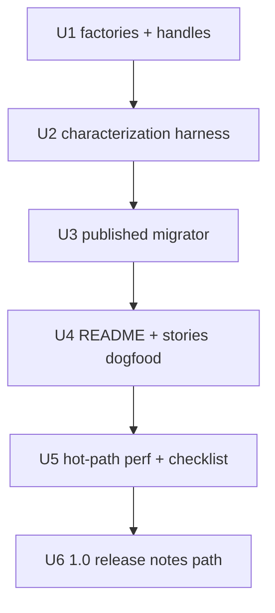

# ScrollScene 1.0 - Plan

## Goal Capsule

- **Objective:** Ship `scrollscene@1.0.0` as a breaking dual-engine release: factory + handle APIs for ScrollMagic-backed and IntersectionObserver-backed scenes, LLM-friendly lifecycle for generation and maintenance, a published codemod dogfooded on this repo, and a written before/after performance checklist both engines must clear — without adding new feature capabilities.
- **Authority:** Product Contract Key Decisions (session-settled) → Planning Contract KTDs → this plan’s Implementation Units. Continues the intentional break deferred by the 0.0.26 hotfix plan.
- **Stop when:** Factories are the documented happy path for both engines; characterization tests + SSR smoke pass; published migrator has rewritten this repo’s README/stories; before/after perf checklist is checked in and both engines clear it; `1.0.0` is ready to release via existing `pnpm release` path.
- **Execution profile:** code — characterization-first for API/lifecycle; smoke-first for Storybook demos and SSR entry.
- **Open blockers:** None.

---

## Product Contract

### Summary

ScrollScene 1.0 replaces the `new`-constructor surface with a shared factory + handle API for both engines, ships a published migrator applied to this repo first, and accepts only with documented before/after performance numbers for each engine. Advanced consumers still reach underlying engine objects; README Next Steps features stay out.

### Problem Frame

The library is still on `0.0.x` with constructor-function APIs, ScrollMagic SSR loaders, and hot paths that allocate large threshold arrays and throttle resize work. `0.0.25` forced an unplanned break; `0.0.26` restored main-entry/SSR compatibility and explicitly deferred a codemod-driven intentional migration. Maintainers want 1.0 for measurable performance and for LLMs that both generate and patch ScrollScene usage — not for feature expansion or competing with GSAP ScrollTrigger as a thesis.

### Key Decisions

- KD1. **Factory + handle over `new` constructors** — ditch constructor/`new` as the public happy path; return plain handles with explicit lifecycle. `(session-settled: user-approved — chosen over keep-new / dual-export: LLM gen+maintain and one migrator beat familiarity)` Governs R1, R2, R8.
- KD2. **Equal product bar for both engines** — ScrollMagic (`ScrollScene`) and IntersectionObserver (`ScrollObserver`) stay first-class and distinct; same API/LLM/perf investment. `(session-settled: user-directed — chosen over Observer- or ScrollMagic-weighted effort: engines are different capabilities, not substitutes)` Governs R1, R3, R6.
- KD3. **Keep advanced engine escape hatch** — expose underlying engine objects for power users; document as advanced, not the happy path. `(session-settled: user-directed — chosen over narrow named actions / drop escape hatch: power-user ScrollMagic methods remain reachable)` Governs R4.
- KD4. **Published codemod + dogfood first** — ship a consumer-runnable migrator and migrate this repo’s demos/docs with it before calling migration done. `(session-settled: user-directed — chosen over repo-only script / guide-only: full migration story)` Governs R7, R8.
- KD5. **Perf acceptance is written before/after numbers** — not vibe-only demo smoothness. `(session-settled: user-directed — chosen over feel-in-demos / single consuming page: checklist is the bar)` Governs R6.
- KD6. **Smallest 1.0: API + migrator + perf checklist only** — no README Next Steps features in this release. `(session-settled: user-approved — chosen over feature-expanded 1.0: floor still delivers the stated value)` Governs R9.
- KD7. **No external-threat gating** — success is the defined API/perf/codemod bar, not beating ScrollTrigger positioning. `(session-settled: user-approved — chosen over competitive-threat-gated 1.0: ship the cleaner faster dual API)` Governs Scope Boundaries.

### Actors

- A1. **Package maintainer** — ships 1.0, dogfoods the migrator, owns the perf checklist.
- A2. **Coding agents / LLMs** — generate new ScrollScene usage and patch existing call sites; need a small, consistent lifecycle surface.
- A3. **App developers** — upgrade via semver-major + migrator; may use advanced engine escape hatches.

### Requirements

**Public API**

- R1. Both engines expose a factory-style create API (not `new` constructors as the documented happy path) that returns a handle with an explicit destroy (and any other shared lifecycle the planning phase names consistently across engines).
- R2. Happy-path options and lifecycle vocabulary are aligned across engines where capabilities overlap; engine-specific options remain where the engines differ.
- R3. ScrollMagic-backed and IntersectionObserver-backed products both ship in 1.0 as first-class, separately capable surfaces — neither is removed or reduced to undocumented compat.
- R4. Handles expose underlying engine objects for advanced use (ScrollMagic Scene/Controller on the ScrollMagic path; IntersectionObserver instance on the Observer path); docs mark this as advanced.
- R5. SSR-safe loading behavior for ScrollMagic-related main-entry concerns remains a product requirement: Node/SSR evaluation must not require `window` for the supported import paths.

**Performance**

- R6. 1.0 ships with a written before/after performance checklist that both engines must clear; metrics cover the hot paths named in KTD4 without inventing new product features.

**Migration**

- R7. A published migrator exists that consumers (and agents) can run against a codebase to apply the 1.0 API break.
- R8. This repository’s demos, stories, and docs are migrated with that same migrator before 1.0 is considered migration-complete.
- R9. 1.0 does not add native setPin-on-Observer, out-of-the-box split-text/svg kits, or a separate Observer package.

### Key Flows

- F1. Create and destroy (happy path)
  - **Trigger:** A2 or A3 needs a scroll-linked scene.
  - **Actors:** A2, A3
  - **Steps:** Import the documented factory; create with options; use handle lifecycle; destroy on teardown.
  - **Outcome:** No `new` constructor required on the happy path.
  - **Covered by:** R1, R2

- F2. Advanced engine escape
  - **Trigger:** A3 needs engine methods beyond the documented happy path.
  - **Actors:** A3
  - **Steps:** Create via factory; reach underlying engine objects on the handle; call engine APIs as today conceptually.
  - **Outcome:** Power features remain reachable without restoring constructor passthrough as the primary API.
  - **Covered by:** R4

- F3. Migrate a consumer codebase
  - **Trigger:** A3 (or A2) upgrades across the breaking 1.0 boundary.
  - **Actors:** A1, A2, A3
  - **Steps:** Bump to 1.0; run published migrator; fix residual advanced cases; verify destroy/lifecycle still correct.
  - **Outcome:** Mechanical API rewrite is tool-assisted; this repo already proves the path.
  - **Covered by:** R7, R8

### Acceptance Examples

- AE1. Factory happy path
  - **Covers:** R1
  - **Given:** Documented 1.0 entry points
  - **When:** A consumer creates a ScrollMagic-backed and an Observer-backed scene
  - **Then:** Both use factory + handle + destroy; `new` is not the documented happy path

- AE2. Escape hatch still works
  - **Covers:** R4
  - **Given:** A ScrollMagic-backed handle and an Observer-backed handle
  - **When:** The consumer needs advanced engine access
  - **Then:** ScrollMagic path reaches Scene/`setPin`-class behavior via handle `scene`/`controller`; Observer path reaches the underlying IntersectionObserver via handle `observer` only (no native setPin — R9)

- AE3. Perf checklist gates release
  - **Covers:** R6
  - **Given:** Before metrics captured on current `0.0.x` hot paths
  - **When:** 1.0 candidates are evaluated
  - **Then:** Both engines show written after numbers that meet the checklist; vibe-only demos are insufficient

- AE4. Migrator dogfood
  - **Covers:** R7, R8
  - **Given:** This repo still contains pre-1.0 call sites
  - **When:** The published migrator runs on the repo
  - **Then:** Demos/stories/docs compile against 1.0 factories without a parallel hand-maintained rewrite as the source of truth

### Success Criteria

- S1. `1.0.0` is the intentional breaking release that completes the migration deferred after `0.0.26`.
- S2. An agent can generate a correct create/destroy snippet for either engine from docs without inventing constructor/`this` patterns.
- S3. The perf checklist is checked in and both engines pass it before publish.
- S4. The published migrator is what transformed this repo’s public examples.

### Scope Boundaries

**Deferred for later**

- Native setPin via ScrollObserver
- Out-of-the-box split-text / SVG line-draw kits
- Moving ScrollObserver to a separate package
- Dual happy-path APIs (`new` + factories) beyond any brief internal transition planning requires
- Forced import-path migration away from main-entry dual export

**Outside this product's identity**

- Replacing GSAP ScrollTrigger as the market default
- Dropping either engine from 1.0
- Feature-expanding 1.0 beyond API, performance, and migration

**Deferred to Follow-Up Work**

- Broader publish/build toolchain replacement (Babel → other bundler) unless a unit proves it is required for factories/types/codemod
- Full Storybook redesign beyond migrating call sites

### Dependencies / Assumptions

- Assumes `0.0.26` remains the compatibility baseline until 1.0; floating `0.0.x` consumers are not forced onto 1.0 without a major bump.
- Assumes ScrollMagic remains an optional peer for Observer-only installs via `scrollscene/observer` (KTD1).
- Assumes performance wins come from rewriting hot paths and allocation behavior, not from new user-facing features.
- Assumes characterization tests are added in-repo (none exist today) as part of 1.0 verification (KTD2).

### Sources / Research

- `docs/plans/2026-08-08-002-fix-compat-hotfix-release-plan.md` — defers forced syntax migration and codemod; verification pattern `build:package` + Node SSR smoke + Storybook.
- `README.md` — dual-engine positioning, Next Steps feature list (out of 1.0), current `new` examples and Scene/Controller escape hatch (~29 `new` sites).
- `src/ScrollScene.ts` — constructor-function API, `init`/`destroy`, `.Scene`/`.Controller` (~390-391), global Controller singleton.
- `src/ScrollObserver.ts` — constructor-function API; `useDuration` → `createArray(199)` (~546-548); no engine object on instance today; `destroyImmediately` re-enters destroy from callback.
- `src/helpers/scrollAnimationInit.ts` — shared breakpoint/resize lifecycle; `lodash.throttle` 700ms.
- `src/helpers/createArray.ts` — threshold array allocation helper.
- `package.json` — `.` and `./observer` exports; Babel dual-build; no `test` script.
- `src/stories/*.stories.jsx` — ~28 `new` call sites; `useEffect` + `.destroy()` cleanup pattern to preserve.

<!-- ce-section: work-relationships -->
### How This Work Fits Together

This plan owns **ScrollScene 1.0 product + implementation scope**. Broader understanding as of 2026-08-08:

- `docs/plans/2026-08-08-002-fix-compat-hotfix-release-plan.md` — **Enables** this work by restoring `0.0.26` compatibility and parking the intentional break here.
- `docs/plans/2026-08-08-001-refactor-storybook-dev-stack-plan.md` — **Can proceed independently of** library 1.0 API work; demo stack already modernized.
- Future feature work from README Next Steps — **Depends on** 1.0 landing first; **Still to decide** in later brainstorms; not Requirements here.

---

## Planning Contract

### Key Technical Decisions

- KTD1. **Keep `.` + `./observer` additive through 1.0** — the break is factory/`new`, not forced import-path migration. `(session-settled: user-approved — chosen over forcing an entry split: LLM-friendly one-import main path stays; Observer-only opt-in remains)` Instantiates KD2, R3, R5. Resolves former Q1.
- KTD2. **Add a minimal characterization test harness** — Vitest (or equivalent lightweight runner) for factory/destroy/SSR/codemod fixtures; do not rely on Storybook alone. `(session-settled: user-approved — chosen over Storybook+manual-only: R6/R1 need durable proof)` Instantiates R1, R5, R6.
- KTD3. **Public factories `createScrollScene` / `createScrollObserver` returning plain handles** — shared shape `{ destroy, … }`; ScrollMagic handle exposes `scene` + `controller`; Observer handle exposes `observer`. Do not export constructable `ScrollScene`/`ScrollObserver` from the public barrel in 1.0 (factories only) so LLMs cannot keep generating `new`. Instantiates KD1, KD3, R1, R2, R4.
- KTD4. **Perf checklist metrics (both engines where applicable)** — (1) Observer `useDuration` threshold array length/allocation cost vs baseline `createArray(199)`; (2) resize-path listener/throttle behavior vs 700ms `scrollAnimationInit` baseline; (3) GSAP scrub write coalescing (rAF / skipped no-op progress writes) under duration scrub. Capture before on `0.0.26` behavior, after on 1.0, write results in `docs/perf-checklist.md` (or sibling under `docs/`). Include at least one scripted micro-benchmark (threshold allocation) runnable via `pnpm test` so the checklist is not manual-only. Instantiates KD5, R6. Resolves former Q2.
- KTD5. **Published migrator ships with the npm package** — add a package `bin` plus published files so `npx`/`pnpm exec` works after install (extend `package.json` `files` beyond `dist`, or emit migrator artifacts into published paths). Transform rewrites `new ScrollScene(`/`new ScrollObserver(` to factories and `.Scene`/`.Controller` → handle `scene`/`controller`; dogfood on `README.md` + `src/stories/**` before release. Instantiates KD4, R7, R8.
- KTD6. **Preserve SSR loaders** — keep client-only ScrollMagic require pattern in `src/scrollmagic-with-ssr.ts` / add-indicators; Storybook shim stays Storybook-only. Instantiates R5.
- KTD7. **Sequence: API → tests → codemod → dogfood → perf baseline/fix → checklist → release** — do not run repo-wide codemod until handle property names are frozen by tests.

### High-Level Technical Design

Both engines keep separate modules (`src/ScrollScene.ts`, `src/ScrollObserver.ts`) with mirrored factory/handle vocabulary. Shared breakpoint wiring stays in `src/helpers/scrollAnimationInit.ts`. Main barrel and `./observer` entry continue to export both surfaces per KTD1.

### Implementation Constraints

- Prefer `function` declarations in library source (existing repo style; no arrow-function churn for its own sake).
- Do not change published demo behavior beyond API migration and perf internals.
- Codemod must be safe on JSX `useEffect` cleanup bodies that call `.destroy()`.
- Observer escape hatch is net-new on the handle (parity with Scene/Controller) — document as advanced.

### Assumptions

- Vitest is an acceptable default test runner; swap only if install/build friction blocks progress.
- Exact factory export names above are the plan default; renaming requires updating codemod + docs in the same change set.
- Major version publish uses existing `pnpm release` / release-it flow after `prepublishOnly` build.

### Sequencing

1. U1 factory/handle API + types + barrel exports  
2. U2 characterization + SSR smoke automation  
3. U3 migrator package/bin  
4. U4 dogfood README/stories with migrator  
5. U5 perf baseline, hot-path fixes, checklist doc  
6. U6 changelog/README LLM-oriented examples + release readiness  

### System-Wide Impact

- **Public API / LLM surface:** Every README and story example trains agents; factory naming and escape properties must stay consistent across barrels, types, codemod, and docs (U1→U3→U4→U6).
- **SSR / peer graph:** Main entry still touches ScrollMagic loaders; Observer-only path must remain peer-free via `./observer` (KTD1, KTD6).
- **Demo site:** Storybook stories are both tests-of-record for visuals and dogfood targets — broken cleanup after codemod regresses the public demo.
- **Release train:** Major bump is the first intentional break after the 0.0.26 hotfix deferral; messaging must distinguish hotfix (no code change) from 1.0 (codemod required).

### Risks & Dependencies

- **Codemod + JSX effects:** Transforms can break `useEffect` cleanup; mitigate with fixtures (U3) and Storybook build (U4).
- **Observer escape is new:** Adding `observer` on the handle is parity, not a 0.0.x behavior — document clearly so agents do not invent other names.
- **Global Controller singleton:** Factory rewrite must not create per-call controllers when `useGlobalController` defaults true.
- **Perf measurement noise:** Checklist methods must record environment and methodology so before/after comparisons stay honest.
- **No prior test suite:** U2 is on the critical path; without it, API/perf claims stay anecdotal.

---

## Implementation Units

### U1. Factory + handle API for both engines

- **Goal:** Replace documented `new` constructors with `createScrollScene` / `createScrollObserver` returning plain handles; expose advanced engine objects; keep SSR-safe main entry.
- **Requirements:** R1, R2, R3, R4, R5
- **Flows / examples:** F1, F2, AE1, AE2
- **Dependencies:** None
- **Files:** `src/ScrollScene.ts`, `src/ScrollObserver.ts`, `src/index.ts`, `src/observer.ts`, related `.d.ts` emit via existing type build
- **Approach:** Refactor constructor-function bodies into factories that return handles (`destroy`, and aligned lifecycle). Map ScrollMagic `Scene`/`Controller` onto handle `scene`/`controller`. Add Observer handle `observer`. Keep global Controller singleton behavior. Preserve breakpoint init via `scrollAnimationInit`. Export factories only from public barrels (no constructable `ScrollScene`/`ScrollObserver`). Freeze property names for codemod (U3).
- **Test scenarios:**
  - Factory returns handle with `destroy` for both engines (AE1)
  - ScrollMagic handle exposes `scene` and `controller` (AE2)
  - Observer handle exposes `observer` (AE2)
  - Main entry and `./observer` still export Observer; main still exports Scene factory
  - Node require of main entry does not throw on missing `window` (ScrollMagic undefined-or-safe)
  - `destroyImmediately` path still tears down without double-free errors
- **Verification:** U2 tests green for API surface; `pnpm run build:package` succeeds

### U2. Characterization test harness

- **Goal:** Add a minimal Vitest (or equivalent) suite proving factory/handle/SSR contracts so 1.0 is not Storybook-only.
- **Requirements:** R1, R5
- **Flows / examples:** AE1, AE2
- **Dependencies:** U1
- **Files:** new `src/**/*.test.ts` (or `tests/`), `package.json` scripts, Vitest config as needed
- **Approach:** Prefer jsdom/node tests for factory shape and destroy; Node-only smoke for SSR entry. Keep suite small and fast. Wire `pnpm test`.
- **Test scenarios:**
  - `pnpm test` runs and fails closed if factories missing
  - SSR smoke: requiring built commonjs main does not access `window`
  - Handle escape properties exist as specified in U1
- **Verification:** `pnpm test` passes on CI-equivalent local run

### U3. Published codemod

- **Goal:** Ship a consumer-runnable migrator rewriting `new ScrollScene` / `new ScrollObserver` to factories and updating escape property access if renamed.
- **Requirements:** R7
- **Flows / examples:** F3, AE4
- **Dependencies:** U1 (frozen names), U2 preferred
- **Files:** `codemod/` (or equivalent) + `package.json` `bin` + published `files` entries; fixture inputs/outputs under tests
- **Approach:** AST transform (jscodeshift or equivalent). Ensure the migrator is included in the npm tarball (not source-only). Cover plain JS/TS and JSX story patterns. Document `npx`/`pnpm exec` invocation in README migration section.
- **Test scenarios:**
  - Fixture: `new ScrollScene({…})` → `createScrollScene({…})`
  - Fixture: `new ScrollObserver({…})` → `createScrollObserver({…})`
  - Fixture: `scrollScene.Scene` → `handle.scene`
  - Fixture: `useEffect` cleanup still calls `.destroy()` after transform
  - Idempotent second run does not corrupt already-migrated code
- **Verification:** Codemod unit fixtures pass; dry-run on repo shows expected hit count (~50+ sites)

### U4. Dogfood migrator on README + stories

- **Goal:** Migrate this repo’s public examples with the published migrator; no parallel hand rewrite as source of truth.
- **Requirements:** R8, R9
- **Flows / examples:** F3, AE4
- **Dependencies:** U3
- **Files:** `README.md`, `src/stories/*.stories.jsx` (12 files)
- **Approach:** Run migrator; fix residual manual cases; ensure stories keep `destroy` on unmount; update docs so factories are the only happy-path examples; keep Next Steps features listed but not implemented.
- **Test scenarios:**
  - No remaining documented happy-path `new ScrollScene` / `new ScrollObserver` in README
  - Stories build under Storybook after migration
  - Advanced escape examples use handle engine properties (F2)
- **Verification:** `pnpm run build:storybook` succeeds; spot-check key stories in `pnpm run storybook`

### U5. Performance hot paths + written checklist

- **Goal:** Capture before metrics on `0.0.26` behavior, improve hot paths, write after metrics both engines must clear.
- **Requirements:** R6
- **Flows / examples:** AE3
- **Dependencies:** U1 (can baseline before API freeze using current code; after metrics require U1)
- **Files:** `src/ScrollObserver.ts`, `src/helpers/createArray.ts`, `src/helpers/scrollAnimationInit.ts`, `src/ScrollScene.ts` as needed, `docs/perf-checklist.md`
- **Approach:** Measure KTD4 metrics. Reduce wasteful threshold allocation on `useDuration`, tighten resize work, preserve scrub coalescing correctness. Record method, environment, before/after numbers, and pass/fail in the checklist doc.
- **Test scenarios:**
  - Checklist includes all three KTD4 metrics with before and after (AE3)
  - Scripted threshold-allocation micro-benchmark runs under `pnpm test` and records a comparable number for the checklist
  - Observer duration scrub still reaches expected timeline progress behavior in characterization or story smoke
  - No regression in breakpoint init/destroy across resize
- **Verification:** Checklist checked in with both engines passing; `pnpm test` still green including perf fixture

### U6. LLM-oriented docs + 1.0 release readiness

- **Goal:** Document factory happy path for agents; note advanced escapes; prepare major release messaging for the break deferred after 0.0.26.
- **Requirements:** R1, R7, S1–S4
- **Flows / examples:** F1, F3, AE1, AE4
- **Dependencies:** U4, U5
- **Files:** `README.md`, changelog/release notes as used by release-it, `package.json` version via release flow
- **Approach:** Lead README examples with factories + destroy. Short “migrate with codemod” section. Do not implement Next Steps features. Ready `pnpm release` for `1.0.0` (actual npm publish may be operator-gated).
- **Test scenarios:**
  - README create/destroy snippet has no `new` on happy path (S2)
  - Migration section names the published bin command
  - Version/release config ready for major bump
- **Verification:** Docs review against AE1–AE4; `pnpm run build:package` clean

---

## Verification Contract

| Gate | Command / artifact | Proves |
|------|-------------------|--------|
| Unit/characterization | `pnpm test` | U1/U2/U3 fixtures |
| Package build | `pnpm run build:package` | dual CJS/ESM + types |
| SSR smoke | `node -e "require('./dist/commonjs/index.js')"` (no `window` throw; ScrollMagic safe on Node) | R5 |
| Storybook | `pnpm run build:storybook` (+ optional `pnpm run storybook` smoke) | U4 demos |
| Lint | `pnpm run lint` | no eslint regressions in touched files |
| Perf | `docs/perf-checklist.md` before/after for KTD4 metrics + `pnpm test` micro-benchmark fixture | R6 |
| Migrator dogfood | published bin run on README + stories; no happy-path `new` left | R7, R8 |

---

## Definition of Done

**Global**

- [ ] Product Contract R1–R9 satisfied; no README Next Steps features shipped
- [ ] Factories are the only documented happy path for both engines
- [ ] Characterization tests + SSR smoke + Storybook build pass
- [ ] Published migrator exists and was the source of truth for repo migration
- [ ] Perf checklist checked in; both engines clear KTD4 metrics
- [ ] Abandoned experimental API/codemod paths removed from the diff
- [ ] Ready for `1.0.0` release via existing release tooling (publish may wait on maintainer)

**Per unit**

- [ ] U1: handles + escapes + SSR-safe exports
- [ ] U2: `pnpm test` harness green
- [ ] U3: migrator fixtures + bin
- [ ] U4: README/stories dogfooded
- [ ] U5: checklist with before/after pass
- [ ] U6: LLM-oriented docs + release readiness
